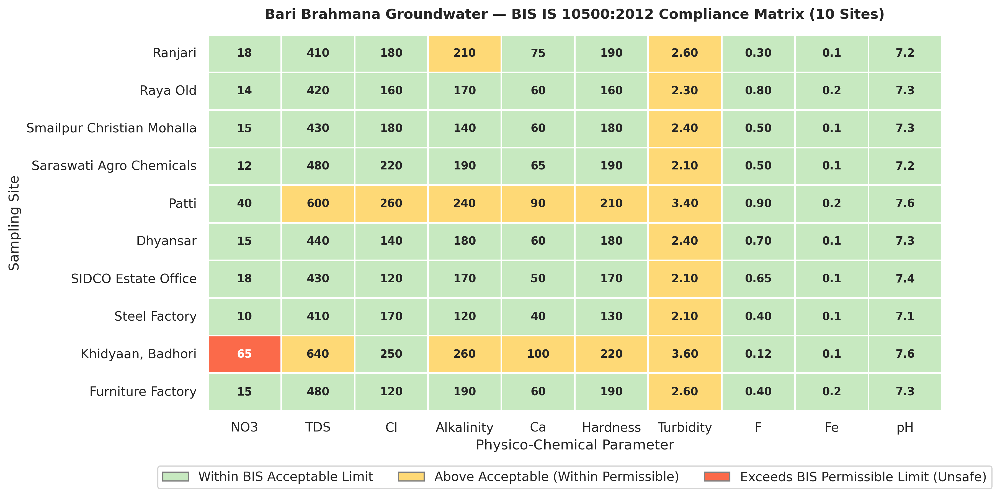
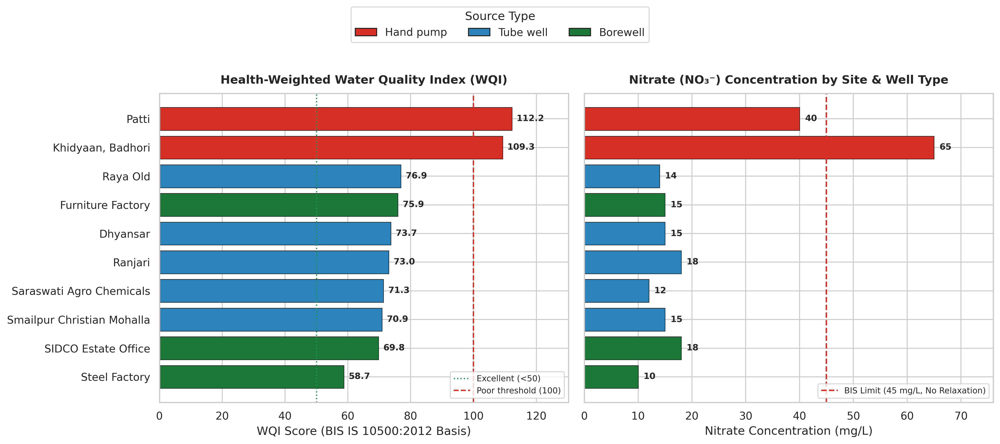
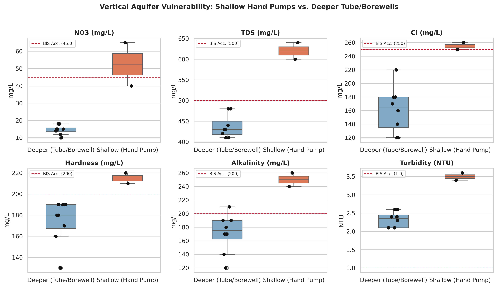
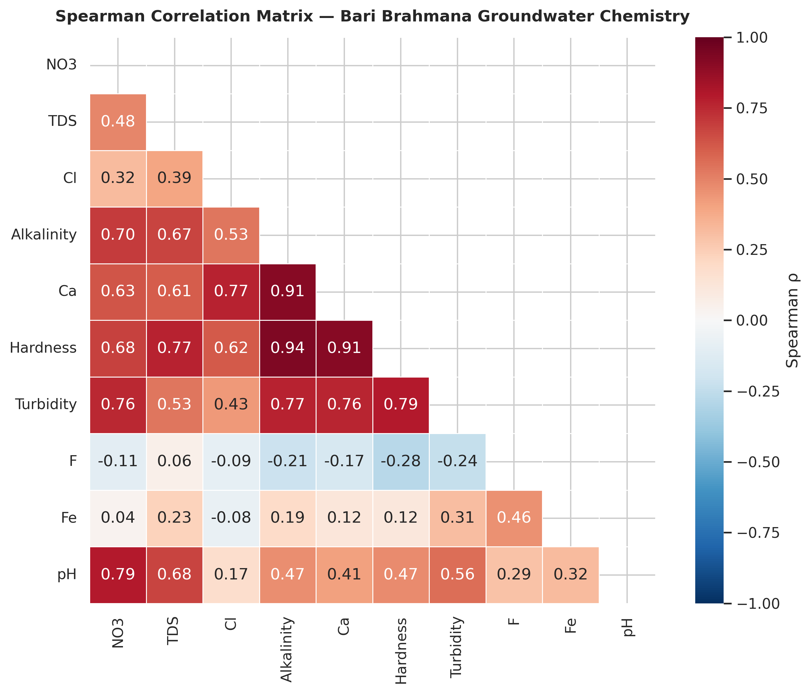

# Groundwater Contamination & Vertical Aquifer Vulnerability Audit — Bari Brahmana Industrial Belt (Samba, J&K)

A reproducible Python hydrogeochemical pipeline digitising and analysing primary pre-monsoon fieldwork and laboratory data collected across **10 groundwater sources** (5 tube wells, 3 borewells, 2 hand pumps) in the **Bari Brahmana industrial corridor, Samba District, Jammu & Kashmir** (`32°38'30"N, 74°55'30"E`, Kandi–alluvial foothill zone).

Originally conducted for my BSc (Hons) Geology dissertation at Cluster University of Jammu (2023), this repository modernises the raw physico-chemical dataset with automated **BIS IS 10500:2012** two-tier compliance auditing, a health-weighted **Water Quality Index (WQI)**, shallow-vs-deep aquifer stratification, and Spearman rank correlation analysis.

---

## Key Findings

| Metric | Result |
|---|---|
| **Total Sampling Sites** | 10 (2 Hand pumps, 5 Tube wells, 3 Borewells) |
| **WQI Range (BIS IS 10500:2012 Basis)** | **58.71** (Steel Factory) to **112.23** (Patti) |
| **WQI Classification Split** | **8 Good** (`50–100`, all deeper wells) · **2 Poor** (`100–200`, both hand pumps) |
| **Shallow Hand Pump vs. Deeper Well WQI** | **110.75** vs. **71.27** (+55.4% higher degradation index in shallow zone) |
| **Shallow vs. Deeper Mean Nitrate (NO₃⁻)** | **52.5 mg/L** vs. **14.6 mg/L** (3.6× enrichment in hand pumps) |
| **Shallow vs. Deeper Mean TDS** | **620.0 mg/L** vs. **437.5 mg/L** (+41.7% higher mineralisation) |
| **Hard BIS Permissible Limit Breaches** | **1 / 10 sites** — Khidyaan, Badhori (`NO₃⁻ = 65 mg/L` vs. `45 mg/L` no-relaxation limit) |
| **BIS Acceptable Limit Exceedances (≥1 param)** | **10 / 10 sites** (driven uniformly by Turbidity `2.10–3.60 NTU` > `1.0 NTU` acceptable, though all stay within `5.0 NTU` permissible) |
| **Strongest Monotonic Pair with Nitrate** | pH (`Spearman ρ = 0.79`) |

---

## Hydrogeochemical Interpretation

1. **Vertical Aquifer Stratification Controls Vulnerability:**
   The sharpest control on water quality is extraction depth rather than proximity to heavy industrial plots. Both shallow **hand pumps** (Patti and Khidyaan, Badhori) show co-elevated Nitrate (`40–65 mg/L`), TDS (`600–640 mg/L`), Chloride (`250–260 mg/L`), Alkalinity (`240–260 mg/L`), Calcium (`90–100 mg/L`), Hardness (`210–220 mg/L`), and Turbidity (`3.40–3.60 NTU`). By contrast, all 8 deeper **tube wells and borewells**—including those at SIDCO Estate Office, Steel Factory, and Saraswati Agro Chemicals—exhibit significantly lower solute loads (`NO₃⁻: 10–18 mg/L`, `TDS: 410–480 mg/L`), indicating that surface-derived anthropogenic nitrate and dissolved salts primarily impact the unconfined shallow horizon while deeper semi-confined strata remain comparatively buffered.
2. **Why Composite WQI Ranks Patti Above Khidyaan Despite a Nitrate Breach:**
   Although **Khidyaan, Badhori** is the only site violating a health-critical BIS no-relaxation limit (`NO₃⁻ = 65 mg/L`, posing methemoglobinemia risk), **Patti** records a slightly higher aggregate WQI (`112.23` vs. `109.27`). This occurs because WQI integrates weighted sub-indices across all 10 parameters: Patti combines near-limit Nitrate (`40 mg/L`) with elevated Fluoride (`0.90 mg/L` vs. `0.12 mg/L` at Khidyaan), higher Iron (`0.2` vs. `0.1 mg/L`), and higher Chloride (`260 mg/L`). Pairing a composite index with a parameter-level compliance matrix prevents severe single-contaminant breaches from being masked.
3. **Turbidity Baseline Across the Corridor:**
   Every sampled source exceeded the BIS *Acceptable* turbidity guideline (`1.0 NTU`), yet none crossed the *Permissible* limit (`5.0 NTU`), suggesting modest suspended particulate mobilisation across both shallow and deeper wells during pre-monsoon pumping.

---

## Visual Outputs

### 1. Two-Tier BIS IS 10500:2012 Compliance Matrix


### 2. Health-Weighted Water Quality Index (WQI) & Nitrate Hotspot Profile


### 3. Vertical Aquifer Contrast: Shallow Hand Pumps vs. Deeper Tube/Borewells


### 4. Spearman Rank Correlation Matrix


---

## Data QA & Reproducibility Notes

* **Primary Fieldwork Protocol:** 1 L pre-cleaned polyethylene bottles filled without air bubbles, stored at `4 °C`, and analysed within 12–24 hours via EDTA titrimetry (Total Hardness, `Ca²⁺`), argentometric titration (`Cl⁻`), atomic absorption photometry (`F⁻`), and gravimetric/flame photometric estimation (`NO₃⁻`).
* **Digitisation QA Fixes Logged in Code:** Two typographical printing errors from the original 2023 bound report Table 2 were audited and corrected during digitisation:
  1. Sample 10 (*Furniture Factory*) printed Iron (`Fe`) as `02` instead of `0.2 mg/L` (verified against the report's computed mean of `0.13 mg/L` and text range `0.1–0.2 mg/L`).
  2. The Chloride column header printed `Cr` instead of `Cl⁻` (confirmed by the analytical methods and `120–260 mg/L` Chloride section).
* **WQI Weighting Scheme:** Computed using BIS IS 10500:2012 acceptable limits with standard health-priority weights (`w = 5` for `NO₃⁻`, `F⁻`; `w = 4` for `Fe`, `TDS`, `pH`; `w = 3` for `Cl⁻`, `Turbidity`, `Hardness`; `w = 2` for `Alkalinity`, `Ca²⁺`).

---

## Limitations & Scope Constraints

* **Sample Size (`n = 10`):** With only 2 shallow hand pumps versus 8 deeper wells, Mann–Whitney U tests are strictly exploratory; expanded shallow-well sampling around Badhori and Patti is needed to delineate the plume boundary.
* **Single-Season Snapshot:** Sampling occurred during the pre-monsoon period; post-monsoon resampling is required to quantify recharge dilution versus seasonal nitrate leaching.
* **Geolocation Integrity:** Individual well GPS coordinates were not logged during the 2023 undergraduate survey; accordingly, no synthetic point map was fabricated.

---

## Repository Structure

```text
bari-brahmana-groundwater-hydrochemistry/
├── 01_bari_brahmana_hydrochemistry.ipynb          
├── outputs/
│   ├── data/
│   │   ├── bari_brahmana_groundwater_2023.csv     # Digitised & QA-verified primary dataset
│   │   ├── bari_brahmana_wqi_results.csv          # Site-wise WQI scores and classifications
│   │   └── shallow_vs_deep_stratification.csv     # Vertical zone summary statistics
│   └── figures/
│       ├── fig1_bis_compliance_matrix.png
│       ├── fig2_wqi_and_nitrate_profile.png
│       ├── fig3_shallow_vs_deep_aquifer.png
│       └── fig4_spearman_correlation.png
├── requirements.txt
└── README.md
